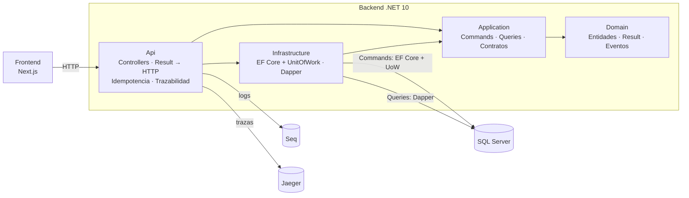

# Mundialito Corporativo

Sistema de gestión de un torneo de fútbol corporativo: equipos, jugadores, calendario de partidos,
resultados, tabla de posiciones y goleadores. Prueba técnica de desarrollador .NET.

**Stack:** .NET 10 · ASP.NET Core (Controllers) · EF Core + Dapper · SQL Server 2022 · Next.js 16 ·
Serilog + Seq · OpenTelemetry + Jaeger · xUnit + Testcontainers · Docker.

## Levantarlo

Requisito: Docker. Un solo comando levanta todo, crea la base, aplica las migraciones y siembra datos de
ejemplo (4 equipos, 20 jugadores, 6 partidos, 3 con resultado):

```bash
docker-compose up --build
```

| Servicio | URL |
|---|---|
| Frontend | http://localhost:3000 |
| API | http://localhost:5000 (por ejemplo, http://localhost:5000/api/standings) |
| Seq (logs) | http://localhost:5341 |
| Jaeger (trazas) | http://localhost:16686 |

> **Windows:** si al clonar aparece *"Filename too long"*, clonar en una ruta más corta o activar rutas largas:
> `git clone -c core.longpaths=true <url>`.

`docker-compose down -v` borra todo; el próximo `up` vuelve a sembrar. La contraseña de SQL Server tiene un
valor de demo; para usar otra, copiar [.env.example](.env.example) a `.env`.

## Probarlo

| Qué | Cómo |
|---|---|
| **Postman** | Importar [postman/](postman/) (colección + entorno *Mundialito - Docker*) y *Run collection*: 52 requests con 171 tests (idempotencia, filtros, paginación, errores). Desde la terminal: `npx newman run postman/Mundialito.postman_collection.json -e postman/Mundialito-Docker.postman_environment.json` (en PowerShell, `npx.cmd`). |
| **Tests unitarios** | `cd backend && dotnet test tests/Mundialito.UnitTests` (46 tests, sin Docker) |
| **Tests de integración** | `cd backend && dotnet test tests/Mundialito.IntegrationTests` (14 tests contra un SQL Server real en Docker, con Testcontainers) |
| **Frontend** | http://localhost:3000: tabla, goleadores, equipos (crear, editar, eliminar, registrar jugadores), partidos (filtros, programar), registrar o corregir resultados (con autogoles) |
| **Trazabilidad** | Toda respuesta trae `X-Trace-Id`. Buscarlo en Seq (`@TraceId = '...'`) y en Jaeger (*Search* → *Trace ID*) |

## Arquitectura

Clean Architecture en cuatro proyectos, con CQRS: las escrituras pasan por el dominio, EF Core y el
Unit of Work; las lecturas, exclusivamente por Dapper con paginación en la base.



Cinco diagramas (despliegue, capas, flujo de escritura, flujo de lectura y trazabilidad) en
[docs/ARQUITECTURA.md](docs/ARQUITECTURA.md).

## Cómo se cumple cada requisito

| § | Requisito | Dónde |
|---|---|---|
| 2 | Clean Architecture | 4 proyectos; las referencias hacen cumplir las dependencias. Application solo depende de Domain |
| 3 | CQRS | Commands en `Application/*/Commands` (EF Core + UoW). Queries: contrato en Application, SQL con Dapper en `Infrastructure/Queries` |
| 4 | Unit of Work | `Infrastructure/Persistence/UnitOfWork.cs`: transacción explícita, un commit por Command; `SaveChanges` bloqueado fuera de él |
| 5 | Result Pattern | `Domain/Results`. La Api traduce a 200/201/204/400/404/409 con ProblemDetails + `code` |
| 6 | REST + idempotencia | GET/POST/PUT/PATCH/DELETE; DELETE y PUT idempotentes; `Idempotency-Key` obligatoria en POST (filtro `[Idempotent]`, tabla `IdempotencyRecords`, reserva atómica) |
| 7 | Observabilidad | Serilog (logs estructurados, nivel según el resultado), CorrelationId/TraceId en cada log y respuesta, duración por request, OpenTelemetry → Jaeger, eventos de dominio guardados y loggeados con su TraceId |
| 8 | Funcional | Equipos (CRUD, filtros, orden), jugadores por equipo, partidos (fecha, equipo, estado), tabla (puntos → diferencia → goles a favor) y goleadores |
| 9 | Seed | `Infrastructure/Seeding`: automático al iniciar si la base está vacía, a través del dominio y el UoW |
| 10 | Filtros y paginación | Todos los listados: `pageNumber`, `pageSize` (máx. 100), `sortBy` (lista blanca), `sortDirection` y filtros; `OFFSET/FETCH` en SQL |
| 11 | Frontend | [frontend/](frontend/): Next.js desacoplado (capa `lib/api`, Server Components y Server Actions) |
| 12 | Docker | [docker-compose.yml](docker-compose.yml), [backend/Dockerfile](backend/Dockerfile), [frontend/Dockerfile](frontend/Dockerfile) |
| 13 | Diagrama | [docs/ARQUITECTURA.md](docs/ARQUITECTURA.md) |
| 14 | Postman | [postman/](postman/) |
| 15 | Tests | [backend/tests/](backend/tests/): 46 unitarios + 14 de integración |

El detalle de cada decisión, con alternativas y motivos, está en [docs/DECISIONES.md](docs/DECISIONES.md).
El orden en que se construyó, paso a paso, en [ROADMAP.md](ROADMAP.md). Los requisitos resumidos, en
[docs/ENUNCIADO.md](docs/ENUNCIADO.md).

## Estructura

```
backend/
  src/
    Mundialito.Domain/          Entidades, Result Pattern, eventos de dominio
    Mundialito.Application/     Commands, Queries, contratos (IUnitOfWork, repositorios...)
    Mundialito.Infrastructure/  EF Core, UnitOfWork, Dapper, idempotencia, seed, migraciones
    Mundialito.Api/             Controllers, ProblemDetails, idempotencia, observabilidad
  tests/
    Mundialito.UnitTests/
    Mundialito.IntegrationTests/
frontend/                       Next.js 16
postman/                        Colección + entornos
docs/                           ARQUITECTURA.md · DECISIONES.md · ENUNCIADO.md
docker-compose.yml
```

## Desarrollo local (sin Docker para la API)

```bash
docker-compose up -d db seq jaeger            # SQL Server (14333), Seq y Jaeger
cd backend && dotnet run --project src/Mundialito.Api --launch-profile http    # http://localhost:5092
cd frontend && npm install && npm run dev     # http://localhost:3000 (API_URL por defecto: localhost:5092)
```

En desarrollo, la API escribe logs legibles en consola (con `corr=` y `trace=`), además de Seq y Jaeger.
