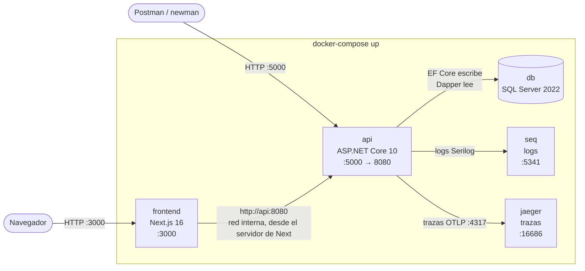
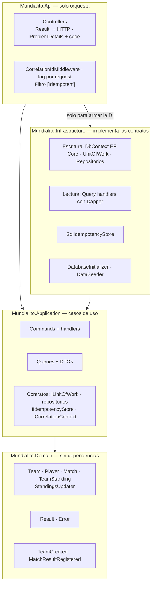
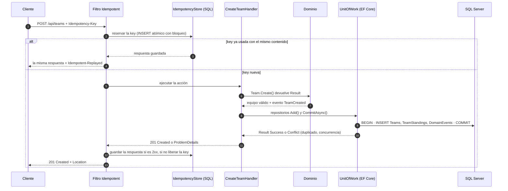
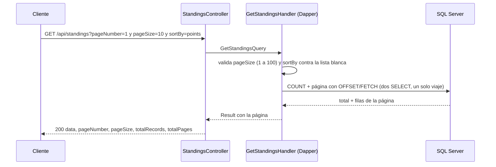
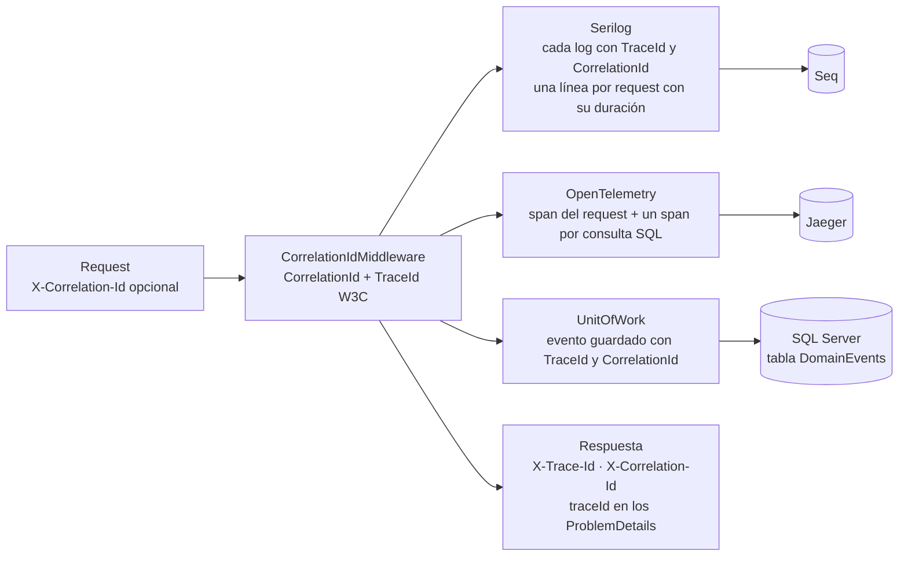

# Arquitectura — Mundialito Corporativo

Cinco vistas, cada una responde una pregunta. Entre todas cubren lo que pide el §13: capas, CQRS,
EF Core (escritura), Dapper (lectura), Unit of Work, almacenamiento de idempotencia, eventos, logs,
flujo de traza, frontend y Docker. El *porqué* de cada decisión está en [DECISIONES.md](DECISIONES.md).

| Vista | Pregunta |
|---|---|
| [1. Despliegue](#1-despliegue-docker) | ¿Qué corre y cómo se conecta? |
| [2. Capas](#2-capas-clean-architecture) | ¿Quién depende de quién? |
| [3. Escritura](#3-escritura-command-ef-core--unit-of-work) | ¿Qué pasa en un POST/PUT? (idempotencia, UoW, EF Core, eventos) |
| [4. Lectura](#4-lectura-query-dapper) | ¿Qué pasa en un GET? (Dapper, paginación en la base) |
| [5. Trazabilidad](#5-trazabilidad-logs-trazas-y-eventos) | ¿Cómo se sigue un request? (CorrelationId, TraceId, Seq, Jaeger) |

---

## 1. Despliegue (Docker)

Un `docker-compose up` levanta los cinco servicios. Dentro de la red de Docker se encuentran por nombre.

- El **navegador nunca habla con la API**: el frontend la llama desde el servidor de Next (Server Components
  y Server Actions). Sin CORS y sin exponer la URL de la API al navegador.
- La API **migra y siembra la base sola** al arrancar (con reintentos mientras SQL Server se inicia).

---

## 2. Capas (Clean Architecture)

Las flechas son referencias entre proyectos: el compilador impide cualquier otra dependencia.

| Capa | Depende de | Contiene |
|---|---|---|
| Domain | nada | Reglas del negocio: entidades que se validan solas, `Result`, eventos, la regla de la tabla |
| Application | Domain | Casos de uso (Commands y Queries) y los **contratos** que necesita (sin EF ni Dapper) |
| Infrastructure | Application | Implementaciones: EF Core + UnitOfWork para escribir, Dapper para leer, idempotencia, seed |
| Api | Application + Infrastructure | Controllers que traducen HTTP ↔ Commands/Queries y `Result` → status code |

---

## 3. Escritura (Command, EF Core + Unit of Work)

Ejemplo: `POST /api/teams`. Todo Command termina en **un** `CommitAsync`: una transacción con los
cambios de todos los repositorios y sus eventos de dominio.

- **Unit of Work:** único punto que guarda (`SaveChanges` bloqueado fuera de él). Traduce los rechazos de la
  base (índice único, `rowversion`) a `Result` con 409, sin excepciones como control de flujo.
- **Eventos de dominio:** se guardan en la tabla `DomainEvents` en la misma transacción y se loggean después
  del commit.
- **Idempotencia:** misma key y mismo contenido → misma respuesta; otro contenido → 422; en curso → 409.

---

## 4. Lectura (Query, Dapper)

Ejemplo: `GET /api/standings`. Exclusivamente Dapper: SQL directo a DTOs, paginado en la base.

- **Nunca se trae todo a memoria:** viajan como máximo 100 filas por consulta.
- **`sortBy` seguro:** el texto del usuario solo se busca en un diccionario; al SQL llega la columna escrita
  por nosotros (sin SQL Injection), con el Id como desempate para que las páginas sean estables.
- **Tabla de posiciones:** se lee de `TeamStandings` (ya calculada en cada resultado) con `RANK()` sobre
  puntos → diferencia de gol → goles a favor.

---

## 5. Trazabilidad (logs, trazas y eventos)

Un mismo **TraceId** une la respuesta, los logs, la traza y los eventos guardados.

Para seguir un request: copiar el `traceId` de la respuesta (o de un error) → buscarlo en **Seq**
(`@TraceId = '...'`) para ver sus logs → abrirlo en **Jaeger** para ver cada paso con su duración →
consultarlo en `DomainEvents` para ver los eventos que generó.
